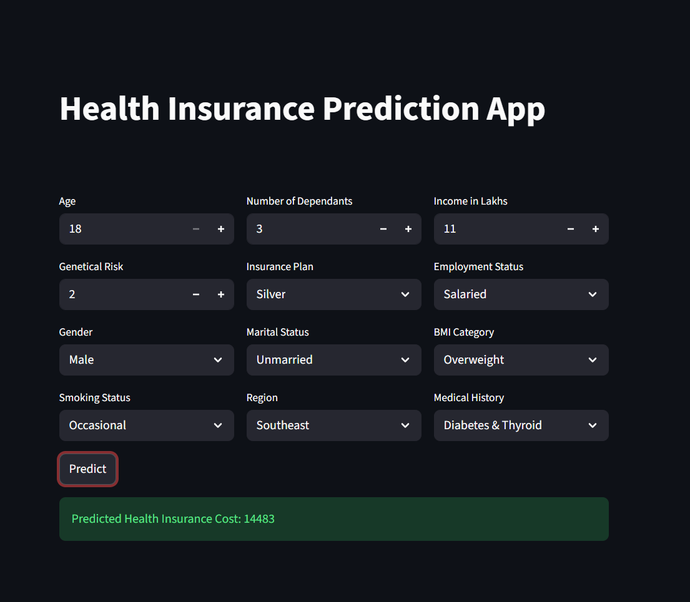

# 🏥 Health Insurance Premium Prediction

A Machine Learning web application that predicts estimated health insurance premiums based on user information and health-related attributes.

The application uses trained regression models and a Streamlit interface to provide predictions interactively.

## 📸 Application Preview



## ✨ Features

- Predict estimated health insurance premiums from user inputs.
- Use separate trained models for different age groups.
- Apply saved preprocessing scalers before generating predictions.
- Interactive web interface built with Streamlit.
- Modular prediction logic for easier maintenance.

## 🛠️ Tech Stack

| Technology | Purpose |
|---|---|
| Python | Core programming language |
| Pandas | Data handling |
| Scikit-learn | Machine learning and preprocessing |
| Joblib | Loading saved models and scalers |
| Streamlit | Interactive web application |

## 📂 Project Structure

```text
Health-Insurance-Premium-Prediction/
│
├── app/
│   ├── main.py
│   └── prediction_helper.py
│
├── artifacts/
│   ├── best_model_young.joblib
│   ├── best_model_rest.joblib
│   ├── scaler_with_cols_young.joblib
│   └── scaler_with_cols_rest.joblib
│
├── assets/
│   └── health-insurance-app.png
│
├── .gitignore
├── requirements.txt
└── README.md
```

## ⚙️ Installation and Setup

### 1. Clone the repository

```bash
git clone https://github.com/vatsabhishek66-arch/Health-Insurance-Premium-Prediction.git
```

### 2. Navigate to the project directory

```bash
cd Health-Insurance-Premium-Prediction
```

### 3. Create and activate a virtual environment (optional but recommended)

**Windows PowerShell**

```powershell
python -m venv .venv
.\.venv\Scripts\Activate.ps1
```

### 4. Install dependencies

```bash
python -m pip install -r requirements.txt
```

### 5. Run the application

Run this command from the project root directory:

```bash
python -m streamlit run app/main.py
```

Streamlit will display a local URL in your terminal. Open that URL in your browser.

## 🧠 How It Works

1. The user enters the required information through the Streamlit interface.
2. The application processes the input features using the prediction helper.
3. The appropriate saved model and corresponding scaler are selected based on the application's age-group logic.
4. The input features are transformed using the saved preprocessing artifacts.
5. The trained regression model generates an estimated insurance premium.
6. The application displays the prediction to the user.

## 📦 Model Artifacts

The `artifacts/` directory contains the trained models and preprocessing scalers used by the application.

- `best_model_young.joblib` — trained model for the younger age group.
- `best_model_rest.joblib` — trained model for the remaining age group.
- `scaler_with_cols_young.joblib` — preprocessing scaler for the younger age group.
- `scaler_with_cols_rest.joblib` — preprocessing scaler for the remaining age group.

## ⚠️ Limitations

- Predictions depend on the data and patterns learned during training.
- Estimated premiums may differ from actual insurer quotations.
- The application is intended for educational and demonstration purposes, not as a substitute for an official insurance quote.

## 👨‍💻 Author

**Abhishek Vats**

GitHub: [@vatsabhishek66-arch](https://github.com/vatsabhishek66-arch)

---

*Built as a machine learning project to demonstrate model deployment and interactive prediction using Streamlit.*
